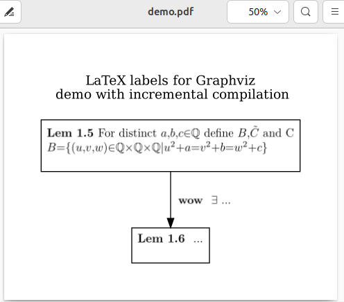
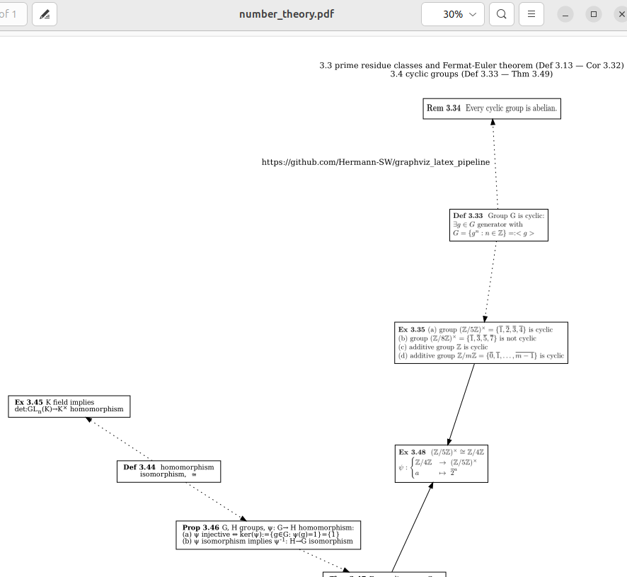
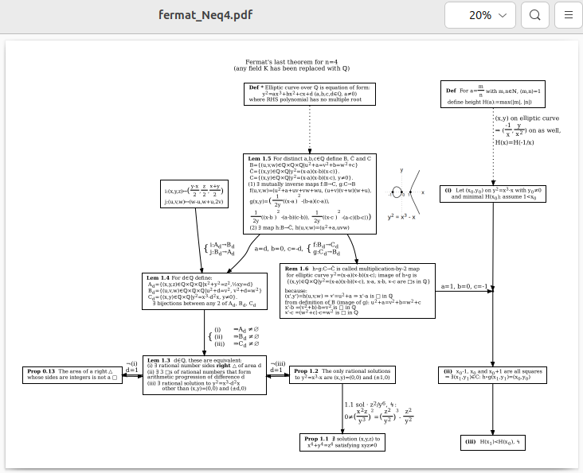

# graphviz_latex_pipeline

New ```texdot.py``` tool is result of less than 1h chat with Gemini Pro (for first complete functioning). It enables LaTeX labels for Graphviz nodes and edges. The adustable LaTeX template is stored in graph ```comment``` attribute. Executing ```./texdot.py demo.dot``` will
- parse demo.dot using ```pydot``` interface
- create temporary .tex file for each LaTeX label
- create ```Makefile``` to orchestrate the work
- use ```latexmk``` to compile into .pdf file
- use ```pdftocairo``` to create needed image
- execute ```dot``` to create final .pdf
- execute ```evince``` to display the result

When run first a lot of output will appear. When run again without changes in the LaTeX labels, incremental compilation avoids regeneration of the (generated from LaTeX) images:  
```
hermann@8840hs:~/graphviz_latex_pipeline$ ./texdot.py demo.dot 
Extracted 3 LaTeX definitions (0 newly written/updated).
Running make...
dot -Tpdf demo_processed.dot -o demo.pdf
Successfully generated demo.pdf.
Opening demo.pdf in evince...
hermann@8840hs:~/graphviz_latex_pipeline$ 
```

To get rid of the many temporary files just execute ```make clean```, it deletes the Makefile as well.

## Usage: Adding LaTeX to Nodes and Edges

To render LaTeX inside your Graphviz diagrams, simply add a `comment` attribute to your node or edge containing the LaTeX code. `texdot.py` will handle the rest.

### ⚠️ Important Rules for LaTeX Nodes & Edges
When using the `comment` attribute for LaTeX rendering, the following strict rules apply:

* **REQUIRED:** You must provide the `comment` attribute containing your LaTeX code.
* **FORBIDDEN:** You **must not** include a `label` or `image` attribute. If either is present alongside a `comment`, the compiler will abort to prevent silent overwrites.

**Example of correct usage:**
```dot
...
    lem_1_5 [comment="
\textbf{Lem 1.5 }For distinct $a,b,c\in \Q$ define $B, \tilde{C}$ and C\\
$B=\{(u,v,w)\in \Q\times\Q\times\Q\vert u^2+a=v^2+b=w^2+c\}$\\"]
    ex_1_6 [shape=plaintext style=filled color=yellow comment="
\textbf{Ex 1.6 } ...\\
"]

    lem_1_5 -> ex_1_6 [comment="
\textbf{wow } $\exists\ \dots$\\
"]

}
```

And this is 50% size PDF view of created result:  



## work in progress

Transforming [number_theory.dot](number_theory.dot) from old system to new, 4 node labels (of 37) on right side of screenshot below are processed with ```texdot.py```. Since there are no ```comment``` attributes in the not yet transformed 33 node labels, ```texdot.py``` can process the whole document, all the time. 3 node labels using the old system can be seen on left side. The HTML label content in number_theory.dot node and edge labels was created with the [old tool](https://gist.github.com/Hermann-SW/12c7644ac0c75b4eb019f76c3f023fe5).

Below is the adaptable LaTeX template in graph ```comment``` attribute. I had to add package for ```\psi```, and added shortcut for $\mathbb{Z}$ as well. I commented out the math spacing removal for now:  
```dot
    comment="
\documentclass[varwidth=true, border=5pt]{standalone}
\usepackage{amsmath, amsfonts, amsthm, amssymb}

\newcommand\Z{\ensuremath{\mathbb{Z}}}

\begin{document}
% Remove automatic math spacing
%\thinmuskip=0mu
%\medmuskip=0mu
%\thickmuskip=0mu

\end{document}
"
```

I use ```vi``` editor since 1990, and write+compile is just done with ```:w|!T```, with:
```bash
$ cat /usr/local/bin/T
#!/bin/bash
./texdot.py number_theory.dot
$
```




## work in progress 2

File [fermat_Neq4.dot](fermat_Neq4.dot) got graph ```comment``` attribute with LaTeX template and therefore can be processed with ```./texdot.py fermat_Neq4.dot```. Nothing else has been transformed yet, so the whole proof diagram currently looks like compiled with the old tool:  
<a href="res/fermat_Neq4.pdf"></a>  
I really like the proof by contradiction in single edge label middle bottom.

